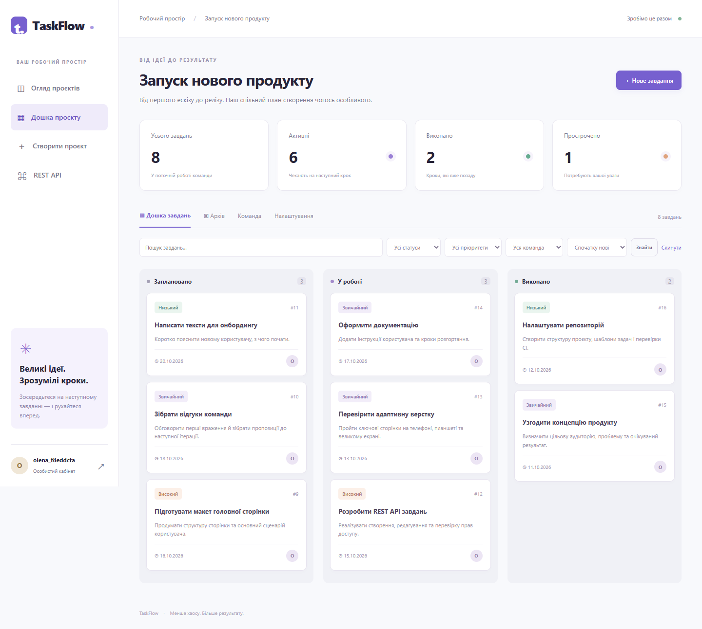
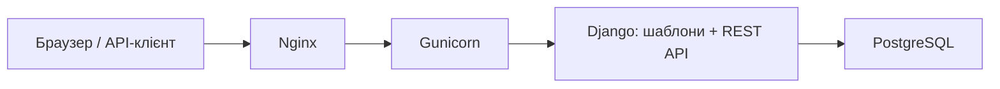

# TaskFlow

Вебзастосунок для керування особистими та командними завданнями.
Приватні проєкти, дошка завдань, виконавці, обговорення, архів і статистика.

Окрема гілка **`taskflow-team-project`**. Це самостійний проєкт; гілки PASASA не змінені.



## Запуск через Docker — рекомендовано

Потрібні Git, Docker з Compose та Python 3 для генерації `.env`.

```sh
git clone --branch taskflow-team-project --single-branch https://github.com/X3Ra4/pasasa-final-project.git taskflow
cd taskflow
python tools/init_env.py
docker compose up --build -d
```

Відкрити **http://127.0.0.1:8088**, натиснути «Зареєструватися» та створити власний акаунт.
Паролі не задані в коді. `.env` генерується з випадковими секретами та не потрапляє в Git.
Перша збірка завантажує образи та залежності; готовність: `docker compose ps`.

Для демоданих виконайте команду, замінивши `your_username` своїм ім’ям користувача:

```sh
docker compose exec web python manage.py seed_demo --owner your_username
docker compose exec web python manage.py createsuperuser
```

Демодані: 3 проєкти та 8 завдань із різними статусами. Повторний запуск не перезаписує
наявні записи з тими самими назвами. `createsuperuser` потрібен лише для адміністратора.
Адмінпанель: `/admin/`. REST API: `/api/`.

Зупинка: `docker compose down`. Том PostgreSQL зберігається; `down -v` видалить базу, його не використовуйте для звичайної зупинки.
Порт прив’язаний до localhost; зовнішнє розгортання описано окремо.

## Можливості

- Реєстрація, вхід, вихід через POST; стандартне хешування паролів Django.
- CRUD проєктів і завдань; власник керує командою за точним username.
- Учасники читають і коментують; виконавець змінює статус своїх активних завдань.
- Статуси «Заплановано», «У роботі», «Виконано»; пріоритети та терміни.
- Пошук за назвою/описом, фільтри, сортування, пагінація, архівування та відновлення.
- Статистика активних, виконаних і прострочених завдань.
- REST API з Session/Token authentication, валідацією та тими самими обмеженнями доступу.
- PostgreSQL, міграції, транзакційні блокування для одночасних змін.
- Адаптивний український інтерфейс, локальний Bootstrap — без CDN-залежності під час роботи.

## Відповідність завданню

Джерело: [«Командний проєкт з веброзробки»](https://fs3.itstep.org/api/v1/files/OglORTTEylKLIPWca5zCzAgTt51hO8P2?inline=true).
Обрана тематика відповідає варіанту «Список справ» із розширенням для команд.

| Вимога | Реалізація / доказ |
|---|---|
| Оформлений опис | [Тема і бізнес-вимоги](docs/PROJECT_TOPIC.md) |
| Frontend і backend | Django Templates, Bootstrap, CSS, JS; Django + DRF |
| База даних | PostgreSQL у Compose; моделі та міграції `board/` |
| Контроль версій | Git, окрема гілка, коміти |
| Документація користувача | [USER_GUIDE.md](docs/USER_GUIDE.md) |
| Інструкція розгортання | [DEPLOYMENT.md](docs/DEPLOYMENT.md) |
| Додатково: контейнерне розгортання | Docker Compose: PostgreSQL + Gunicorn + Nginx |
| Додатково: зовнішній API | [API.md](docs/API.md), `/api/` |
| Баг-трекер і планування | [TRACKER.md](docs/TRACKER.md), GitHub Issues, шаблони issue/PR |
| Тестування | [TEST_REPORT.md](docs/TEST_REPORT.md), автоматичні тести й браузерний сценарій |
| Командна організація | [TEAM_PROCESS.md](docs/TEAM_PROCESS.md); фактичний склад визначає викладач |

## Стек і структура

Python 3.12, Django 5.2, Django REST Framework, PostgreSQL 16, Gunicorn, Nginx,
WhiteNoise, Bootstrap 5.3.8. Точні Python-залежності: `requirements.txt`.



`board/models.py` — дані; `policies.py` — доступ, блокування, фільтри та статистика;
`views.py` — сайт; `api.py` — API; `forms.py` — валідація HTML-форм;
`templates/` і `static/` — інтерфейс; `deploy/` — контейнерний запуск;
`tools/` — генерація конфігурації й браузерна перевірка.

## Швидкий запуск без Docker

SQLite використовується лише у локальному режимі розробки.

```sh
python -m venv .venv
```

Windows PowerShell:

```powershell
.venv/Scripts/python -m pip install -r requirements.txt
.venv/Scripts/python manage.py migrate
.venv/Scripts/python manage.py collectstatic --noinput
.venv/Scripts/python manage.py runserver
```

Linux / macOS:

```sh
.venv/bin/python -m pip install -r requirements.txt
.venv/bin/python manage.py migrate
.venv/bin/python manage.py collectstatic --noinput
.venv/bin/python manage.py runserver
```

Адреса: http://127.0.0.1:8000. Django не читає `.env` автоматично: його передає Docker Compose.
Для локального запуску значення задають змінними середовища; без них працює SQLite і DEBUG=1.

## Перевірка

```sh
docker compose exec web python manage.py test --verbosity 2
docker compose exec web python manage.py makemigrations --check --dry-run
docker compose exec web python -m pip check
docker compose exec -e DJANGO_HTTPS=1 web python manage.py check --deploy --fail-level WARNING
```

Браузерний сценарій: встановити `requirements-dev.txt`, мати Google Chrome,
виконати міграції та `collectstatic`, потім `python tools/browser_check.py` у venv.
Скрипт використовує локальний SQLite, створює випадкові тестові акаунти, запускає та зупиняє
сервер на 8767, зберігає 5 скриншотів. Тестові паролі не виводяться й не публікуються.

Перевірки CI налаштовані для цієї гілки в `.github/workflows/tests.yml`.

## Матеріали для захисту

- [Опис проєкту](docs/PROJECT_TOPIC.md)
- [Інструкція користувача](docs/USER_GUIDE.md)
- [Сценарій демонстрації](docs/DEFENSE.md)
- [Звіт перевірок та межі перевірки](docs/TEST_REPORT.md)
- [Екран входу](screenshots/01-login.png), [огляд](screenshots/02-dashboard.png),
  [завдання](screenshots/04-task.png), [мобільна версія](screenshots/05-mobile.png)

Контейнерне розгортання перевірене локально. Публічний домен/сервер не створювалися.
Реальна участь студентів та персональна оцінка визначаються викладачем; історія командних зустрічей не вигадується.
