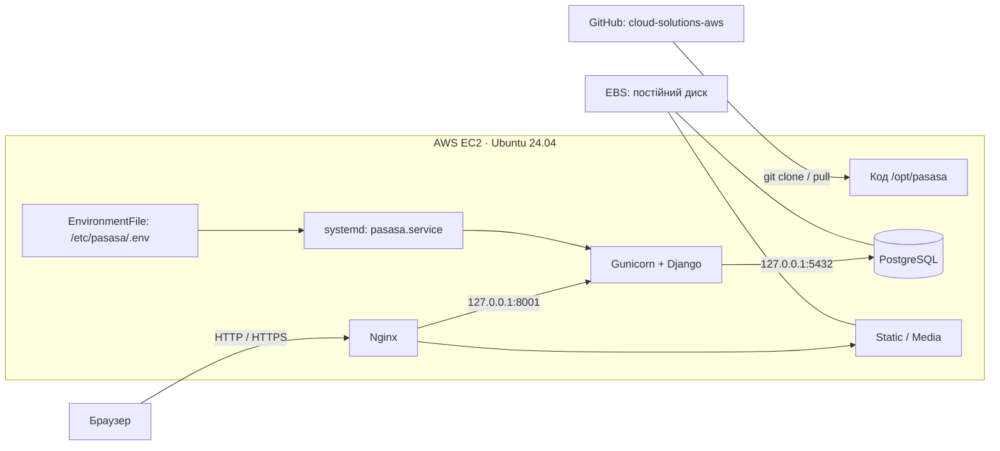

# PASASA Cloud — фінальний проєкт AWS

**Тема:** «Хмарна платформа PASASA для пошуку та оцінювання ігрових локацій ARK: Survival Ascended на базі AWS EC2».

Гілка **cloud-solutions-aws** призначена для Cloud Solutions. Версія Python Web залишається у [main](https://github.com/X3Ra4/pasasa-final-project/tree/main).

> **Статус:** застосунок і конфігурації підготовлено. Реальний EC2 ще не розгорнуто: доступ до сервера не надано. Локальна Linux-перевірка не замінює обов’язковий запуск в AWS.

PASASA надає інтерактивні карти ARK, каталог PvP/PvE-локацій, пошук, CRUD, оцінки та обране. Хмарна частина забезпечує доступ через веббраузер, PostgreSQL, автозапуск застосунку, оновлення з GitHub та зберігання секретів поза кодом.

- [Опис теми для здачі](docs/PROJECT_TOPIC.md)
- [Повна інструкція EC2, systemd, Nginx і HTTPS](docs/CLOUD_DEPLOYMENT.md)
- [Сценарій захисту та докази](docs/CLOUD_DEFENSE.md)
- [Функції застосунку і локальний запуск](docs/PYTHON_WEB_README.md)

## Архітектура



AWS-сервіси запланованої інфраструктури: **EC2** — обчислення, **EBS** — диск; **VPC / Security Groups** — мережевий доступ. PostgreSQL встановлюється на EC2, без RDS/DynamoDB. AWS access keys у застосунку не потрібні.

## Відповідність завданню

[Вимоги CloudSolutionsP35](https://github.com/svitlyi-itstep/CloudSolutionsP35/blob/main/FinalProject.md).

| Вимога | Реалізація / стан |
| --- | --- |
| Реальний EC2 із застосунком | Інструкція та bootstrap готові; фактичний запуск очікується |
| БД на EC2 або DynamoDB | PostgreSQL на localhost; PASASA/settings_cloud.py |
| GitHub і deploy через clone/pull | bootstrap.sh та update.sh використовують цю гілку |
| systemd та автозапуск | pasasa.service; systemctl enable --now pasasa |
| Секрети й endpoint БД у .env через EnvironmentFile | /etc/pasasa/.env, режим 0640; приклад без робочих секретів |
| .gitignore виключає секрети | .env, приватні ключі, БД, оточення, резервні копії виключені |
| README, опис, AWS-сервіси, інструкція | Цей файл і docs/CLOUD_DEPLOYMENT.md |
| Зафіксовані залежності | requirements.txt + requirements-cloud.txt |
| GitHub Actions (бажано) | Автоматичний deploy не налаштований; використовується ручний git pull |

## Швидкий старт на EC2

Новий окремий EC2 з **Ubuntu 24.04 LTS x86_64**. Після SSH-входу як ubuntu:

```bash
sudo apt-get update
sudo apt-get install -y git
git clone --branch cloud-solutions-aws --single-branch https://github.com/X3Ra4/pasasa-final-project.git pasasa-bootstrap
cd pasasa-bootstrap
sudo bash deploy/ec2/bootstrap.sh YOUR_EC2_PUBLIC_DNS
```

Замініть адресу реальною, без http://, шляху чи порту. Початкова установка працює через HTTP для перевірки доступності; перед використанням реальних облікових записів завершіть HTTPS-крок інструкції. Скрипт не перезаписує наявну установку або БД.

Оновлення:

```bash
sudo bash /opt/pasasa/deploy/ec2/update.sh
```

Медіа зберігаються у /var/lib/pasasa/media поза checkout. Оновлення зберігає БД, секрети й налаштований Nginx/TLS.

## Перевірки

Для локальної роботи використовується SQLite. Клонувати цю версію потрібно з --branch cloud-solutions-aws. У віртуальному середовищі з requirements.txt:

```bash
python manage.py test --noinput
python manage.py makemigrations --check --dry-run
```

Відтворювана Linux-перевірка:

```bash
docker build -f deploy/verify/Dockerfile -t pasasa-cloud-verify:course .
docker run --rm pasasa-cloud-verify:course
```

Це локальний тестовий контейнер, не AWS-deploy. Він створює власну PostgreSQL і випадкові тестові секрети, перевіряє тести, міграції, Bash/ShellCheck, синтаксис systemd-unit, Gunicorn через Nginx, static/media. Реальний запуск systemd як PID 1 і автозапуск після reboot перевіряються лише на EC2.

## Демонстрація та файли


Скриншоти зроблено локально, не на AWS. Демодані містять 9 карт і по 6 PvP/PvE-локацій; координати вигадані.

- PASASA/settings_cloud.py — PostgreSQL, HTTPS, окремі static/media.
- maps/health.py — /healthz/: 200 при доступній БД, 503 при збої без розкриття деталей.
- deploy/ec2/ — bootstrap/update/manage, systemd, Gunicorn, Nginx та приклад .env.
- deploy/verify/ — локальна Linux-перевірка.
- docs/ — тема, інструкція та сценарій захисту.

Дизайн розрахований на один навчальний EC2. ARK та ігрові зображення належать їхнім правовласникам; це навчальний фан-проєкт.
