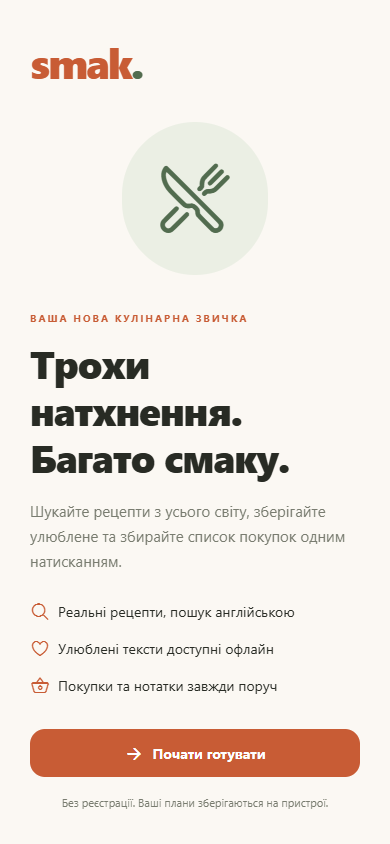
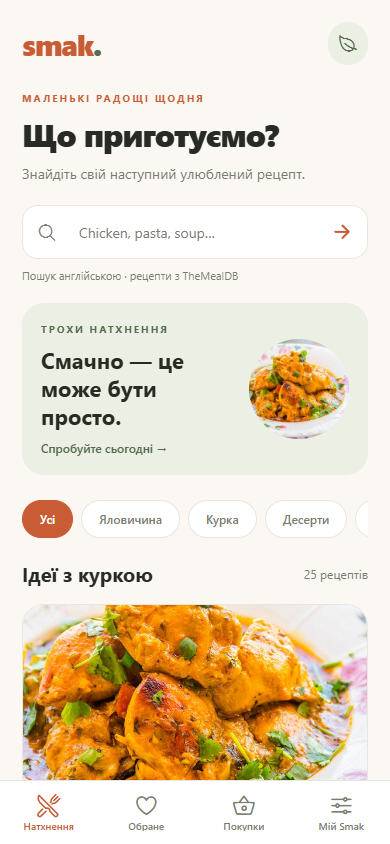
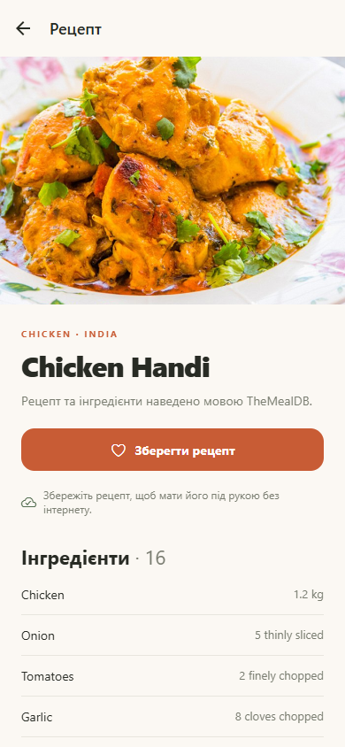
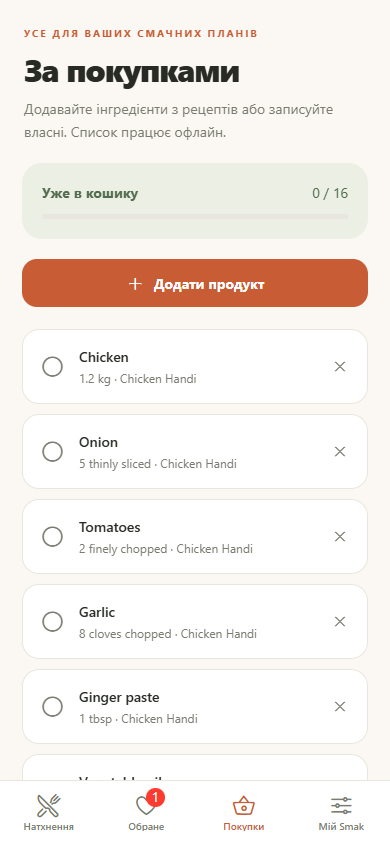
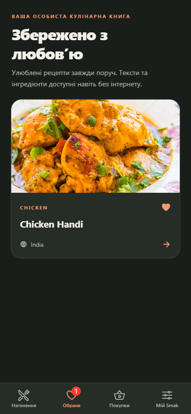
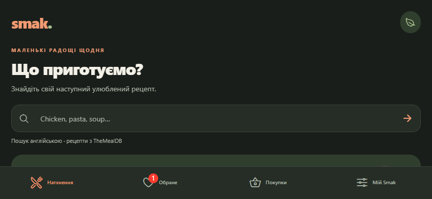

# Smak — кулінарний помічник

Фінальний проєкт React Native P35: мобільний застосунок для людей, які хочуть
знайти рецепт, зберегти його та зібрати покупки перед приготуванням.
Тема «Кулінарний помічник» обрана з переліку [завдання](https://github.com/svitlyi-itstep/ReactNativeP35/blob/main/FinalProject.md).

## Можливості

- Пошук рецептів англійською та серверна фільтрація за категорією.
- Детальний рецепт, інгредієнти, інструкція та посилання на першоджерело.
- Обране з повним текстом для офлайн-доступу; особисті нотатки.
- Список покупок: імпорт інгредієнтів без повторного додавання, власні продукти,
  позначення придбаного, видалення та підтверджене очищення.
- Темна тема, вступ лише під час першого запуску, індикація відсутності мережі.
- Збереження між запусками; помилки запису не стирають попередні дані.
- Адаптивна сітка, портретна й альбомна орієнтації, доступні назви елементів,
  підтримка системного зменшення анімацій.

## Стек і запуск

Створено через `create-expo-app`: Expo SDK 57, React Native 0.86, TypeScript,
Expo Router, Context, AsyncStorage, Animated, expo-image, expo-network.
Потрібен Node.js **22.13+** (рекомендовано Node 22 LTS).

```bash
git clone --branch react-native-final-project --single-branch https://github.com/X3Ra4/pasasa-final-project.git smak
cd smak
npm install
npx expo start
```

Відкрийте QR-код у сумісній з SDK 57 версії Expo Go. Android-версію можна
отримати через [Expo Go](https://expo.dev/go). Комп'ютер і телефон мають бути
в одній мережі. Якщо встановлений Expo Go не підтримує SDK 57, використайте
Android APK із GitHub Actions або локальну нативну збірку.

```bash
npx expo run:android
# macOS + Xcode:
npx expo run:ios
# додатковий браузерний перегляд:
npm run web
```

Для `run:android` потрібні Android Studio, SDK та емулятор або USB-пристрій.
Папки `android/` і `ios/` генеруються Expo, у Git не зберігаються.
Змінні середовища та приватні ключі для навчального запуску **не потрібні**.

## Дані та API

[TheMealDB API](https://www.themealdb.com/api.php), навчальний ключ `1`:
`search.php?s=...`, `filter.php?c=...`, `categories.php`, `lookup.php?i=...`.
Запити справжні; вбудованого підмінного каталогу немає. Тексти рецептів
і назви продуктів залишено мовою джерела. Фото та рецепти належать їхнім
авторам/TheMealDB. Для публікації в магазині застосунків потрібен supporter key
відповідно до умов API. Пошук нових рецептів потребує інтернету.

Обране зберігає текст та інгредієнти повністю. Зображення кешуються expo-image,
але їх доступність офлайн не гарантується: є графічна заглушка.
Дані локальні, без акаунта, синхронізації чи аналітики; видалення застосунку
може видалити їх. Скидання в налаштуваннях потребує підтвердження.

## Екрани

Чотири вкладки: Натхнення, Обране, Покупки, Мій Smak.
Додатково: `meal/[id]`, модальна форма `shopping/new`, onboarding і 404.
У деталі передається лише ID через `router.push`; після onboarding та успішної
форми застосовується `router.replace`, щоб не повертатися до завершеної дії.

Скріншоти нижче з реально запущеної **Expo Web** версії (390×844 та 844×390),
з живим API. Це не макети й не фотографії фізичного телефону.

| Початок | Пошук | Рецепт |
|---|---|---|
|  |  |  |

| Покупки | Темна тема |
|---|---|
|  |  |



## Перевірки та збірка

```bash
npm test
npm run typecheck
npm run lint
npx expo-doctor
npm run export:web
npm run test:e2e
```

Локальний Playwright використовує встановлений Chrome; CI — Chromium.
27 модульних перевірок API/сховища/покупок; браузерні сценарії перевіряють
повний шлях користувача, перезапуск, недоступний API, помилки й відновлення.
Окремий локальний сценарій звертається до живого API та оновлює 6 скріншотів.

[GitHub Actions](https://github.com/X3Ra4/pasasa-final-project/actions/workflows/react-native.yml)
перевіряє типи, lint, тести, Expo Doctor, експорт трьох платформ і браузерний UI.
Окрема задача генерує Android-проєкт, збирає APK та запускає його на емуляторі.
У завершеному успішному запуску завантажте артефакт `smak-android-apk`,
розпакуйте ZIP та встановіть APK на Android. Це навчальна збірка зі стандартним
debug-підписом, не реліз для магазину. `android-smoke-evidence` містить знімки,
UI XML і logcat; статус фактичного прогону дивіться в Actions.

## Структура й захист

`src/app/` — маршрути; `src/core/` — типи, API, перевірки даних і послідовні
операції сховища; `src/state/` — Context; `src/ui/` — тема, компоненти й анімації;
`src/hooks/` — скасування запитів; `e2e/` — інтеграційні сценарії.

[Відповідність вимогам](docs/REQUIREMENTS.md) · [Сценарій захисту на 5–7 хвилин](docs/DEFENSE.md).

Усі обов'язкові програмні можливості реалізовано. Не реалізовано необов'язкові
хмарну синхронізацію, авторизацію, push-сповіщення та переклад рецептів.
Живий захист виконує студент: потрібно запустити застосунок на пристрої або
емуляторі й продемонструвати його викладачеві. iOS-збірка на фізичному пристрої
не перевірялася; браузерні тести не замінюють таку перевірку.
