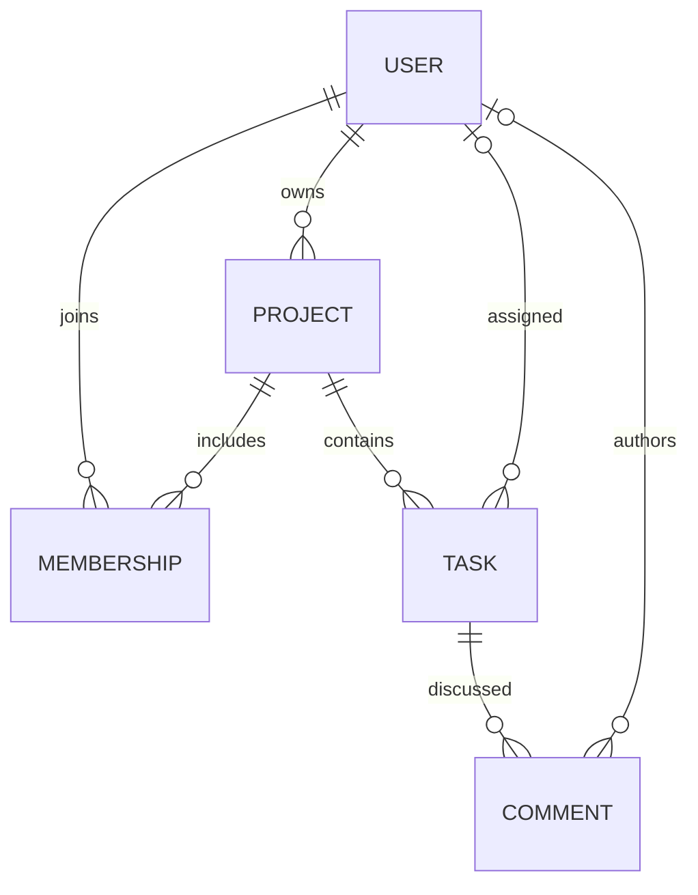

# Тема: вебзастосунок для керування особистими та командними завданнями «TaskFlow»

TaskFlow допомагає організувати роботу та навчання: створювати проєкти, призначати
виконавців, установлювати терміни та бачити результат на спільній дошці.

## Проблема й аудиторія

У студентських і невеликих робочих командах завдання часто губляться в листуванні.
Незрозуміло, хто виконує роботу, коли вона має завершитися та що вже зроблено.
TaskFlow об’єднує ці відомості в приватному робочому просторі.

## Бізнес-вимоги

1. Користувач реєструється та отримує доступ лише до власних і доступних йому командних проєктів.
2. Власник створює, читає, редагує та видаляє проєкти; додає зареєстрованих учасників.
3. Власник керує завданнями: назва, опис, виконавець, пріоритет, термін і статус.
4. Виконавець змінює статус свого активного завдання; інші учасники його переглядають та коментують.
5. Команда знаходить завдання пошуком, фільтрами та сортуванням.
6. Власник архівує завершену або відкладену роботу, за потреби відновлює її.
7. Статистика показує обсяг роботи, виконані та прострочені завдання.
8. Зовнішній клієнт використовує REST API з перевіркою тих самих прав.

Критерій завершення: реєстрація → проєкт → учасник → завдання → виконання → коментар →
архів → відновлення працюють через інтерфейс; сторонній акаунт не має доступу.

## Технології

Frontend: HTML5, CSS3, JavaScript, Bootstrap, Django Templates.
Backend: Python, Django, Django REST Framework. Дані: PostgreSQL і Django ORM.
Розгортання: Docker Compose, Gunicorn, Nginx. Git/GitHub — контроль версій;
GitHub Issues — планування та баг-трекер; GitHub Actions — перевірки.

## Модель даних

Membership унікальний для пари проєкт/користувач. Видалення проєкту видаляє його завдання
та коментарі. Видалення учасника прибирає доступ і його призначення, але зберігає самі завдання.
Видалення акаунта видаляє його власні проєкти; Django Admin показує каскад перед підтвердженням.

## Організація

Репозиторій: X3Ra4/pasasa-final-project, гілка taskflow-team-project.
Фактичний список студентів у повідомленні не надано. Прізвища й особисті внески не вигадані;
їх фіксують за реальною участю, погодженою з викладачем.
Рекомендований розподіл і робочий процес наведено в [TEAM_PROCESS.md](TEAM_PROCESS.md).

Результат — працездатний сайт із документацією, перевірками, REST API та контейнерним запуском.
