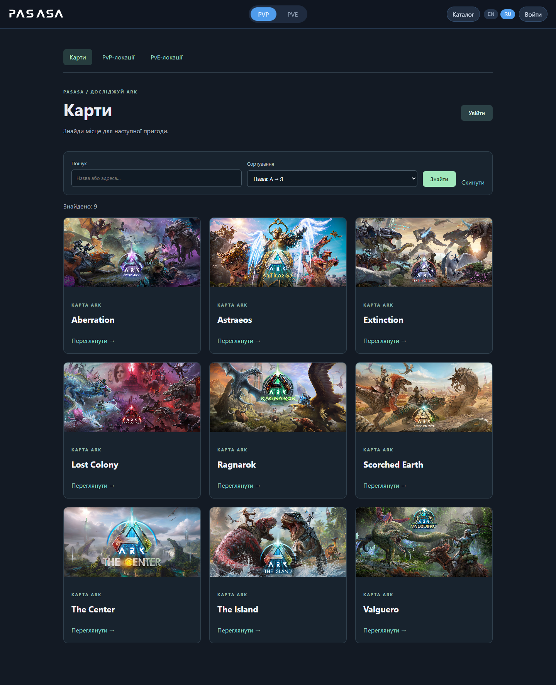
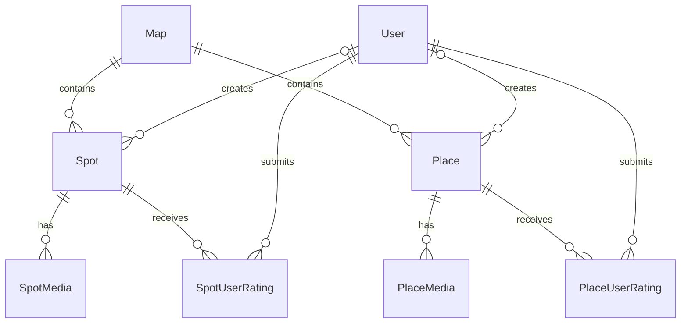
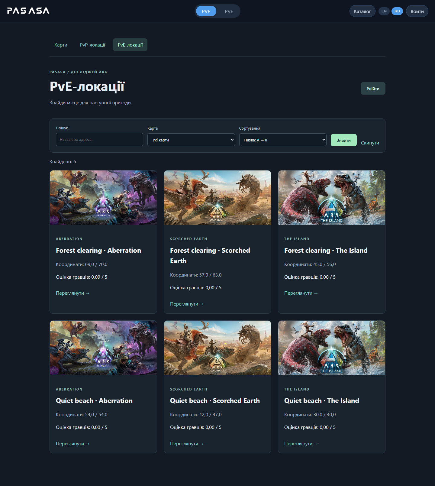
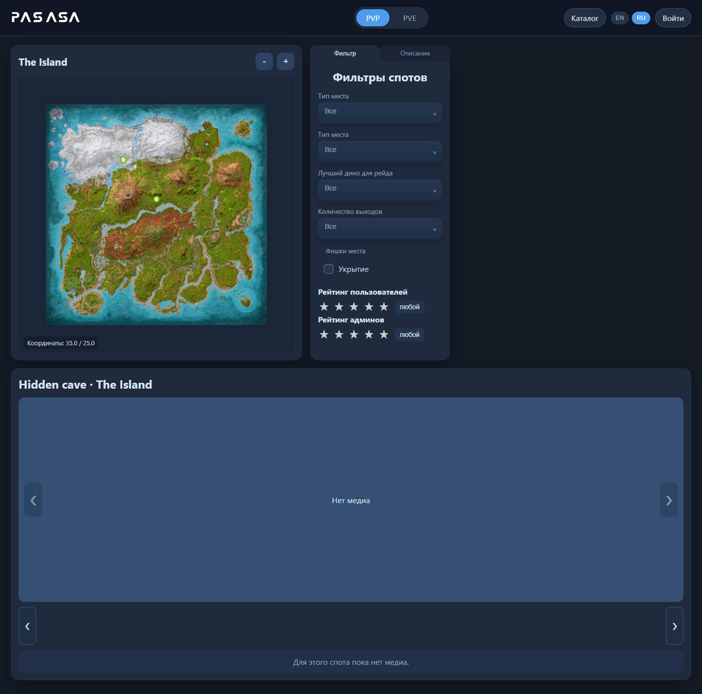
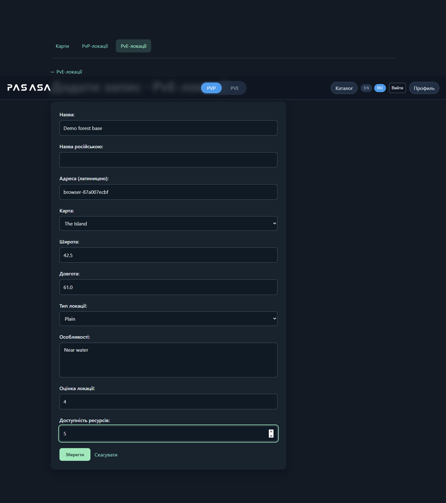
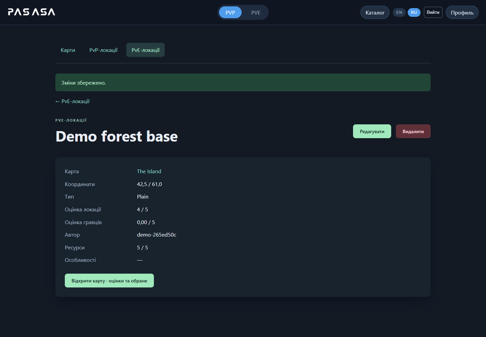

# PASASA — каталог карт і локацій ARK

Фінальний проєкт з розробки вебзастосунків на Python: інтерактивні карти **ARK: Survival Ascended**, каталог PvP/PvE-локацій, оцінки гравців та обране.

**Тема:** «PASASA — вебзастосунок для пошуку, створення та оцінювання ігрових локацій ARK: Survival Ascended».

Мета — допомогти гравцям обирати місця для баз, переглядати їхні координати й характеристики та ділитися власними локаціями. Реалізація використовує Django Templates: сервер формує HTML-сторінки, а JavaScript забезпечує інтерактивну карту, фільтри, оцінювання й обране.



## Можливості

- Каталоги карт, PvP-локацій (`Spot`) та PvE-локацій (`Place`).
- Повний CRUD для кожної основної моделі: список, деталі, створення, редагування, підтверджене видалення.
- Текстовий пошук за назвою та slug, фільтрація за картою, сортування, пагінація по 12 записів.
- Інтерактивні карти з маркерами, характеристиками локацій, оцінками та обраним.
- Реєстрація, вхід, вихід, профіль, зміна пароля та аватара.
- Автор керує своїми локаціями; адміністратор (`is_staff`) керує картами та всіма локаціями.
- Django Admin для довідників, медіа, оцінок та користувачів, із пошуком і фільтрами.
- Зображення карт, фотографії та відео локацій; новини гри із зовнішнього джерела.

## Стек

Python **3.12**, Django **5.2.18 LTS**, SQLite, Django Templates, HTML, CSS, JavaScript, Pillow. Точні версії залежностей зафіксовано в `requirements.txt`.

## Запуск на Windows (PowerShell)

```powershell
git clone https://github.com/X3Ra4/pasasa-final-project.git
cd pasasa-final-project
py -3.12 -m venv .venv
.\.venv\Scripts\python.exe -m pip install -r requirements.txt
.\.venv\Scripts\python.exe manage.py migrate
.\.venv\Scripts\python.exe manage.py seed_demo
.\.venv\Scripts\python.exe manage.py createsuperuser
.\.venv\Scripts\python.exe manage.py runserver
```

Активація віртуального середовища не потрібна. `createsuperuser` запропонує задати ім’я та пароль адміністратора; готових паролів у репозиторії немає.

## Запуск на Linux / macOS

```bash
git clone https://github.com/X3Ra4/pasasa-final-project.git
cd pasasa-final-project
python3.12 -m venv .venv
.venv/bin/python -m pip install -r requirements.txt
.venv/bin/python manage.py migrate
.venv/bin/python manage.py seed_demo
.venv/bin/python manage.py createsuperuser
.venv/bin/python manage.py runserver
```

Після запуску:

| Адреса | Призначення |
| --- | --- |
| http://127.0.0.1:8000/ | Початкова сторінка карт PvP |
| http://127.0.0.1:8000/catalog/maps/ | Каталог і керування картами |
| http://127.0.0.1:8000/catalog/spots/ | Каталог і керування PvP-локаціями |
| http://127.0.0.1:8000/catalog/places/ | Каталог і керування PvE-локаціями |
| http://127.0.0.1:8000/accounts/signup/ | Реєстрація звичайного користувача |
| http://127.0.0.1:8000/accounts/login/ | Вхід користувача або адміністратора |
| http://127.0.0.1:8000/admin/ | Адміністрування довідників та медіа |

## Демонстраційні дані

`seed_demo` створює 9 карт, 6 PvP-локацій, 6 PvE-локацій та необхідні довідники. Координати й характеристики локацій **вигадані для демонстрації** — це не перевірений ігровий гайд. Команда не створює користувачів і паролів. Її можна виконувати повторно: наявні записи та зміни користувача зберігаються.

Демонстраційні локації не мають автора, тому редагувати їх може адміністратор. Щоб перевірити права звичайного користувача, зареєструйтеся та створіть власну локацію кнопкою «+ Додати».

Для додавання зображень/відео локацій увійдіть у `/admin/` і використайте `Spot media` або `Place media`. Для нової карти обкладинка приймає AVIF, а зображення карти — JPG/JPEG. Координати локацій у формах каталогу обмежено діапазоном 0–100.

## Моделі та зв’язки



Типи, особливості, розташування відносно води, динозаври та кількість входів зберігаються в окремих довідниках. Особливості й обране використовують зв’язки Many-to-Many. Для кожного користувача дозволено одну оцінку конкретної локації; повторне оцінювання її оновлює.

## Відповідність завданню

[Умови фінального проєкту](https://github.com/svitlyi-itstep/PythonWebP35/blob/main/FinalProject.md).

| Вимога | Реалізація |
| --- | --- |
| Django Templates або DRF | Django Templates; `templates/` |
| Щонайменше дві пов’язані моделі, база даних | `Map`, `Spot`, `Place`, `User`; SQLite; міграції в репозиторії |
| Моделі зареєстровані в Admin | `maps/admin.py`, `accounts/admin.py` |
| Повний CRUD основних моделей | `maps/catalog.py`, `maps/forms.py`, `maps/catalog_urls.py`; HTML-сторінки `/catalog/` |
| Мінімум два види складних запитів | Пошук через `Q` / `icontains`, фільтр за картою, `order_by`; `maps/catalog.py` |
| Зрозумілий інтерфейс, форми | Каталоги, сторінки деталей, валідовані форми та підтвердження видалення |
| README та інструкція | Цей файл |
| Скриншоти роботи | `screenshots/`, приклади нижче |
| Додатково | Авторизація й ролі, пагінація, ModelForm, налаштований Admin, завантаження медіа |

Карту, яка має локації, не можна видалити: потрібно спочатку перенести або видалити залежні локації. Видалення записів здійснюється POST-запитом після підтвердження; форми захищені CSRF.

## Перевірки

```powershell
.\.venv\Scripts\python.exe manage.py check
.\.venv\Scripts\python.exe manage.py makemigrations --check --dry-run
.\.venv\Scripts\python.exe manage.py test --noinput
```

Тести охоплюють CRUD карт і обох типів локацій, права власника й адміністратора, підміну автора, валідацію координат, захист залежних карт від видалення, пошук/фільтрацію/сортування, реєстрацію, вхід/вихід, повторне заповнення демоданих та новинний сервіс.

Додаткова браузерна перевірка та оновлення скриншотів:

```powershell
.\.venv\Scripts\python.exe -m pip install -r requirements-dev.txt
.\.venv\Scripts\python.exe -m playwright install chromium
# У першому терміналі:
.\.venv\Scripts\python.exe manage.py runserver 127.0.0.1:8765
# У другому терміналі, з тієї самої папки:
.\.venv\Scripts\python.exe tools/browser_check.py
```

Перед браузерною перевіркою потрібно виконати `migrate` та `seed_demo`. Скрипт створює тимчасового користувача й локацію, виконує реальні дії через форми, перевіряє мобільну ширину та прибирає лише власні тестові записи. За потреби `BROWSER_EXECUTABLE` може вказувати шлях до встановленого Chrome.

## Скриншоти

Зняті з локально запущеної програми з демонстраційними даними.

| Каталог локацій | Інтерактивна карта |
| --- | --- |
|  |  |

| Створення локації | Деталі та керування |
| --- | --- |
|  |  |

[Мобільний вигляд](../screenshots/06-mobile.png).

## Налаштування та структура

Для локальної демонстрації конфігурація працює без додаткових змін. Секретний ключ генерується локально у `.local-secret` (цей файл і база даних не потрапляють у Git). Приклади змінних наведено в `.env.example`; програма читає їх із середовища, **не завантажує `.env` автоматично**.

Для власного розгортання задайте `DJANGO_DEBUG=0`, випадковий `DJANGO_SECRET_KEY`, `DJANGO_ALLOWED_HOSTS` і, за потреби, `DJANGO_CSRF_TRUSTED_ORIGINS`. Обслуговування static/media та HTTPS налаштовується окремо; `runserver` призначений для локальної демонстрації.

- `maps/` — моделі, інтерактивні карти, каталог, форми, тести, демодані.
- `accounts/` — користувачі, профіль, реєстрація.
- `templates/`, `static/` — інтерфейс.
- `media/maps/`, `media/hud/` — зображення та оформлення з початкового проєкту.
- `docs/` — опис теми та сценарій захисту.
- `screenshots/` — демонстрація роботи.

Основний каталог працює локально. Для завантаження зовнішніх новин та їх перекладу потрібен інтернет; ці сервіси можуть бути недоступні незалежно від каталогу. Нові сторінки каталогу й документація українською; початковий інтерактивний інтерфейс має EN/RU-перемикач.

ARK та ігрові зображення належать їхнім правовласникам. PASASA — навчальний фан-проєкт; включені графічні матеріали перенесено з початкової версії PASASA.
